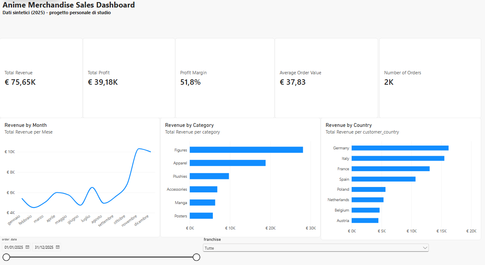
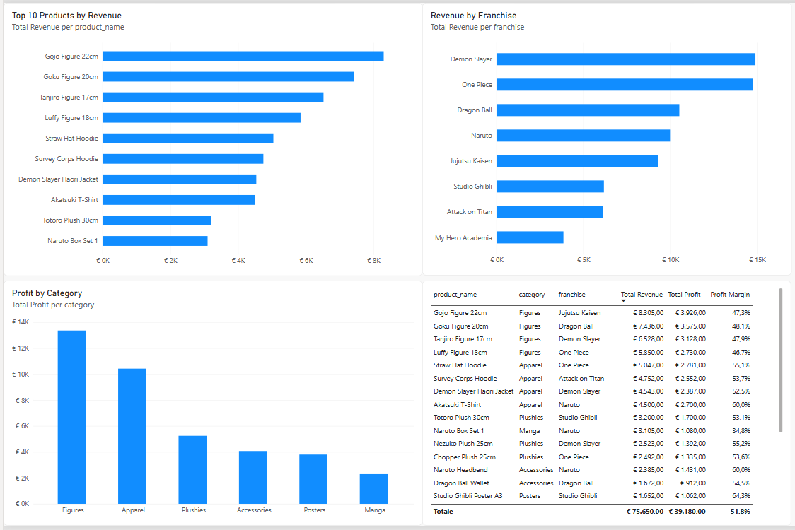

# Anime Merchandise Sales Dashboard

Progetto personale di studio per imparare le basi di Power BI. Non è un caso aziendale reale: i dati sono **sintetici**, generati con uno script Python.

## Scenario

Un piccolo e-commerce europeo fittizio vende merchandise anime e manga importato da Giappone e Cina. La dashboard analizza vendite, profitto, categorie, prodotti, franchise e paesi dei clienti.

## Strumenti

- Python 3 (solo libreria standard) per generare il dataset
- Power BI Desktop: Power Query per la preparazione, DAX per le misure

## Struttura del repository

```
anime-merch-dashboard/
├── data/
│   └── anime_merch_sales.csv
├── scripts/
│   └── generate_dataset.py
├── powerbi/
│   └── anime_merch_dashboard.pbix
├── docs/
│   └── img/
│       ├── overview.png
│       └── products.png
└── README.md
```

## Come riprodurre il progetto

1. Genera il dataset (opzionale, il CSV è già nel repository):
   ```
   python scripts/generate_dataset.py
   ```
   Lo script usa un seed fisso (`random.seed(42)`): ogni esecuzione produce lo stesso file.
2. Apri `powerbi/anime_merch_dashboard.pbix` con Power BI Desktop.
3. Se sposti il CSV, aggiorna il percorso: **Home > Trasforma dati > Impostazioni origine dati**.

## Dataset

2000 ordini del 2025, una riga per ordine con un solo prodotto.

| Colonna | Descrizione |
|---|---|
| order_id | Identificativo dell'ordine |
| order_date | Data dell'ordine |
| customer_country | Paese del cliente (8 paesi europei) |
| category | Categoria (6) |
| franchise | Franchise (8) |
| product_name | Prodotto (24) |
| quantity | Quantità (1-3) |
| unit_price | Prezzo di vendita unitario |
| unit_cost | Costo unitario (acquisto più importazione) |

La stagionalità (più vendite a novembre e dicembre) e i pesi dei prodotti e dei paesi sono scelte inserite nello script: i risultati sono quindi un esercizio, non una scoperta sul mercato.

## Trasformazioni in Power Query

- Controllo dei tipi di dato (date, numeri interi, testo)
- Colonna `Revenue` = `quantity * unit_price`
- Colonna `Profit` = `quantity * (unit_price - unit_cost)`

## Misure DAX

```
Total Revenue = SUM(Sales[Revenue])
Total Profit = SUM(Sales[Profit])
Number of Orders = DISTINCTCOUNT(Sales[order_id])
Profit Margin = DIVIDE([Total Profit], [Total Revenue])
Average Order Value = DIVIDE([Total Revenue], [Number of Orders])
```

## Dashboard

**Pagina 1 - Overview**: 5 KPI, revenue per mese, revenue per categoria, revenue per paese, filtri per data e franchise.



**Pagina 2 - Products**: top 10 prodotti, revenue per franchise, profit per categoria, tabella prodotti.



## Valori di controllo

| KPI | Valore |
|---|---|
| Total Revenue | € 75.650 |
| Total Profit | € 39.180 |
| Number of Orders | 2.000 |
| Profit Margin | 51,8% |
| Average Order Value | € 37,83 |

## Limiti e possibili sviluppi

- Tabella piatta: in un progetto reale userei uno star schema (fatti e dimensioni).
- Nessuna tabella calendario dedicata: uso la gerarchia automatica delle date.
- Un solo prodotto per ordine e nessun dato su clienti, resi o spedizioni.
- Margine alto rispetto a un rivenditore reale, perché i costi sono inventati.
